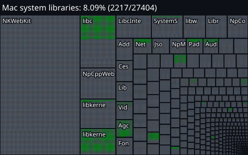

**English** | [Português (Brasil)](docs/user/README.pt-BR.md) | [Español](docs/user/README.es.md) | [简体中文](docs/user/README.zh-CN.md) | [Русский](docs/user/README.ru.md)

# This fork: native Apple ARM64

This branch, `arm64` of [tismalarosta/AnyPS5](https://github.com/tismalarosta/AnyPS5), carries the native Apple ARM64 port from upstream draft pull request [#5021](https://github.com/boykopovar/AnyPS5/pull/5021) by yabanana, merged onto upstream `main`. It compiles the x86-64 code of a PS5 program ahead of time to an ARM64 Mach-O executable, so it runs natively on Apple silicon without Rosetta. It is not part of upstream AnyPS5 and is not endorsed by its maintainers.

Checked on an M5 Pro with macOS 27.0.1 on 31 October 2026:

- The PS5 DOOM homebrew (PPSA99666) plays its three demos natively to 5026, 3836 and 2134 final tics, the same as the reference.
- The SDK GPU cube renders 600 frames, and the compared frames are identical to the reference, pixel for pixel, through MoltenVK.
- The pad consumer passes, and 1094 of 1096 tests in the native AOT build pass; the other 2 fail only inside a sandbox that blocks `/tmp`.
- The native build compiles 2,218 of the 32,934 PS5 system library functions AnyPS5 knows as real code (6.7%), and handles all 1,166 known GPU instructions, as measured by [arm64_progress.py](tools/arm64_progress.py).

Only programs with a reviewed bindings manifest run: this is not general game compatibility. Build steps are in [BUILD.md](docs/dev/BUILD.md#experimental-native-apple-arm64-compiler). Rules for changes, including AI use and what never goes in, are in [ARM64.md](docs/dev/ARM64.md).

The compiler and runtime are yabanana's work in #5021. This branch keeps them current with upstream and adds the requalification, fixes and checks. Like upstream, it is licensed under the GNU General Public License version 2 only.

# About

Tool for automatic executables porting to Linux and Windows.

The relinker-only build runs on macOS, including Apple silicon.

[**Web converter**](https://boykopovar.github.io/AnyPS5/) - files stay on your device.

Includes a [relinker](core/relinker) that converts executable to the target system's native format and implementations of [system prx libraries](core/libs/prx) suitable for dynamic linking. No emulation or separate runtime process.

[**Discord**](https://discord.gg/BHFztBPUe), [Usage](docs/user/USAGE.md), [Build instructions](docs/dev/BUILD.md), [Architecture](docs/dev/ARCHITECTURE.md), [Technical debt of the project](docs/dev/TechnicalDebt.md), [code style conventions](docs/dev/CONVENTIONS.md), [contributing](CONTRIBUTING.md)

## Status

Native Apple ARM64 (Mac) status of this branch:

 

One box per system library, sized by its known functions; green cells compile as real code in the native Mac build, grey cells do not yet.

- System libraries: 2,218 of the 32,934 known PS5 system library functions compile as real code in the native Mac build (Apple-only stubs are not counted). Each function is compiled, not tested one by one.
- GPU: the shader recompiler in the native Mac build handles all 1,166 known GPU instructions. Translated shaders reach Metal through MoltenVK; this counts handled instructions, not shaders checked on screen.

Measured on 31 October 2026 with [arm64_progress.py](tools/arm64_progress.py) on the native ARM64 build. Upstream's Windows and Linux progress is on its [progress page](https://boykopovar.github.io/AnyPS5/progress.html).

* System libraries: percentage of the functions known to the project so far (declared in [core/libs/prx](core/libs/prx)), not of every PS5 system function. The total grows as more functions are declared.

Unsupported or unexpected states throw a C++ exception, usually `std::runtime_error`. An exception that nothing catches prints its `what()` to stderr and ends the process.

The [shader recompiler](core/shader/recompiler/Recompiler.cpp) successfully produces SPIR-V (validated via [Spirv-Tools](3rdparty/SPIRV-Tools) when built with `ANYPS5_ENABLE_SPIRV_TOOLS`).

## Compatibility

Per-game status and test reports live in the [Game bring-up](https://github.com/boykopovar/AnyPS5/discussions/categories/game-bring-up) discussions, one thread per title.

## Input mapping

SDL-mapped game controllers are supported, including analog sticks and triggers. Keyboard and mouse controls can be configured with an `anyps5-input.ini` file. See [input mapping](docs/user/INPUT_MAPPING.md) for the supported devices and configuration format.

## Disclaimer

This project is intended for interoperability, research, preservation, and compatibility purposes. It does not include, distribute, or require copyrighted software, firmware, cryptographic keys, or proprietary libraries. Users are responsible for ensuring that any binaries used with this project are obtained and used in accordance with applicable laws and their respective license terms.

AnyPS5 is an independent project and is not affiliated with, authorized or endorsed by Sony Interactive Entertainment. "PlayStation" and "PS5" are trademarks of Sony Interactive Entertainment Inc.

## License

This project is licensed under the GNU General Public License version 2 only.
